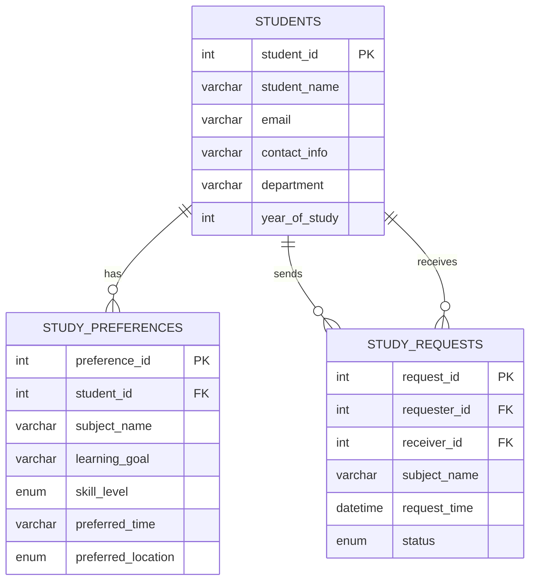

# Study Buddy Matcher

## Project Abstract

Study Buddy Matcher is a web application that helps college students find compatible study partners. Students register profiles, add study preferences (subject, skill level, preferred time and location, learning goal), search for peers who share the same subjects, view a rule-based compatibility score, and send/manage study partnership requests — all backed by a MySQL database.

---

## Problem Statement

Students often struggle to find peers who study the same subjects at compatible times and skill levels. Informal methods (WhatsApp groups, notice boards) are inefficient and do not consider compatibility. This project provides a structured, database-driven solution.

---

## Objectives

- Allow students to register and manage their profiles.
- Allow students to add, edit, and delete study preferences per subject.
- Search for students who share a subject.
- Calculate and display a rule-based compatibility score.
- Send, accept, reject, cancel, and complete study partnership requests.
- Persist all data in MySQL across application restarts.

---

## Technology Stack

| Layer        | Technology                        |
|--------------|-----------------------------------|
| Language     | Java 17                           |
| Framework    | Spring Boot 3.2.5                 |
| Build Tool   | Maven                             |
| Database     | MySQL 8.x                         |
| DB Access    | Spring JDBC / JdbcTemplate        |
| Templates    | Thymeleaf                         |
| Validation   | Jakarta Bean Validation           |
| Frontend     | HTML5, CSS3, Vanilla JavaScript   |

> Spring Data JPA / Hibernate is intentionally NOT used. All SQL is written explicitly to demonstrate DBMS concepts.

---

## Architecture

```
Browser → Controller → Service → Repository (JdbcTemplate) → MySQL
```

- **Controller** — handles HTTP requests, calls services, returns Thymeleaf views or redirects.
- **Service** — business rules, validation, compatibility scoring.
- **Repository** — parameterized SQL queries via `JdbcTemplate`.
- **Model** — plain Java classes (`Student`, `StudyPreference`, `StudyRequest`).
- **Templates** — Thymeleaf HTML pages under `src/main/resources/templates/`.
- **Static** — CSS and JS under `src/main/resources/static/`.

---

## Database Tables

### students
| Column        | Type         | Notes                        |
|---------------|--------------|------------------------------|
| student_id    | INT PK AI    | Auto-increment primary key   |
| student_name  | VARCHAR(100) | Not null                     |
| email         | VARCHAR(150) | Not null, unique             |
| contact_info  | VARCHAR(30)  | Nullable                     |
| department    | VARCHAR(100) | Not null                     |
| year_of_study | INT          | Not null, CHECK 1–6          |

### study_preferences
| Column             | Type         | Notes                                      |
|--------------------|--------------|--------------------------------------------|
| preference_id      | INT PK AI    |                                            |
| student_id         | INT FK       | References students(student_id) ON DELETE CASCADE |
| subject_name       | VARCHAR(100) | Not null                                   |
| learning_goal      | VARCHAR(255) | Not null                                   |
| skill_level        | ENUM         | BEGINNER, INTERMEDIATE, ADVANCED           |
| preferred_time     | VARCHAR(100) | Morning / Afternoon / Evening / Weekend    |
| preferred_location | ENUM         | LIBRARY, CLASSROOM, HOSTEL, ONLINE         |

Unique constraint: `(student_id, subject_name)` — one preference per subject per student.

### study_requests
| Column       | Type      | Notes                                              |
|--------------|-----------|----------------------------------------------------|
| request_id   | INT PK AI |                                                    |
| requester_id | INT FK    | References students                                |
| receiver_id  | INT FK    | References students                                |
| subject_name | VARCHAR   | Not null                                           |
| request_time | DATETIME  | Default CURRENT_TIMESTAMP                          |
| status       | ENUM      | PENDING, ACCEPTED, REJECTED, COMPLETED, CANCELLED  |

CHECK constraint: `requester_id <> receiver_id`.

---

## ER Diagram (Mermaid)



---

## Compatibility Formula

The compatibility score is out of **100 points**:

| Criterion        | Points | Rule                                                                 |
|------------------|--------|----------------------------------------------------------------------|
| Common Subject   | 40     | Always awarded when a candidate shares the searched subject          |
| Learning Goal    | 20     | Normalized exact match (trimmed, lowercased)                         |
| Preferred Time   | 15     | Case-insensitive exact match (Morning ≠ Evening)                     |
| Location         | 15     | Exact match                                                          |
| Skill Level      | 10     | Equal or adjacent in BEGINNER < INTERMEDIATE < ADVANCED              |

> This is a **rule-based compatibility estimate**, not a scientifically validated prediction or machine-learning model.

---

## Project Structure

```
StudyBuddyMatcher/
├── pom.xml
├── README.md
├── .gitignore
├── database/
│   └── study_buddy.sql
└── src/main/
    ├── java/com/studybuddy/
    │   ├── StudyBuddyMatcherApplication.java
    │   ├── config/WebConfig.java
    │   ├── controller/
    │   │   ├── GlobalErrorController.java
    │   │   ├── HomeController.java
    │   │   ├── MatchingController.java
    │   │   ├── PreferenceController.java
    │   │   ├── RequestController.java
    │   │   └── StudentController.java
    │   ├── model/
    │   │   ├── Student.java
    │   │   ├── StudyPreference.java
    │   │   └── StudyRequest.java
    │   ├── repository/
    │   │   ├── PreferenceRepository.java
    │   │   ├── StudentRepository.java
    │   │   └── StudyRequestRepository.java
    │   └── service/
    │       ├── MatchingService.java
    │       ├── PreferenceService.java
    │       ├── StudentService.java
    │       └── StudyRequestService.java
    └── resources/
        ├── application.properties
        ├── static/css/style.css
        ├── static/js/app.js
        └── templates/
            ├── index.html
            ├── error/404.html, 500.html
            ├── matches/search.html, details.html
            ├── preferences/list.html, form.html
            ├── requests/incoming.html, sent.html, partnerships.html, select.html
            └── students/register.html, list.html, details.html, edit.html
```

---

## MySQL Setup

1. Open **MySQL Workbench** and connect to your local MySQL server.
2. Open the file `database/study_buddy.sql`.
3. Click the lightning bolt (Execute) button to run the script.
4. The script creates the `study_buddy` database and all three tables **only if they do not already exist**. It will NOT drop existing data.

---

## Windows Environment Variable Setup

Open **Command Prompt** and set variables for the current session:

```cmd
set DB_URL=jdbc:mysql://localhost:3306/study_buddy?useSSL=false&serverTimezone=UTC&allowPublicKeyRetrieval=true
set DB_USERNAME=root
set DB_PASSWORD=your_mysql_password
```

To set them permanently (System Properties → Environment Variables), add:
- `DB_URL`
- `DB_USERNAME`
- `DB_PASSWORD`

If you leave `DB_PASSWORD` unset, the app defaults to an empty password (suitable if your local MySQL root has no password).

---

## Build and Run

### 1. Compile

```cmd
mvn clean compile
```

### 2. Run

```cmd
mvn spring-boot:run
```

### 3. Open in browser

```
http://localhost:8080/
```

---

## Example Usage Workflow

1. Run the SQL script in MySQL Workbench.
2. Start the application with `mvn spring-boot:run`.
3. Open `http://localhost:8080/`.
4. Register two or more students via **Students → Register**.
5. Add study preferences for each student via **Students → View → Manage Preferences**.
6. Go to **Find Partners**, select a student and subject, click **Search**.
7. Click **Details** on a result to see the compatibility breakdown.
8. Click **Send Study Request**.
9. Go to **Requests → Incoming**, select the receiver student, and **Accept** the request.
10. Go to **Partnerships**, select either student, and **Mark Complete** when done.

---

## Manual Test Checklist

These are suggested manual test cases (not automated):

- [ ] Register a student — verify it appears in the student list.
- [ ] Register with a duplicate email — verify error message shown.
- [ ] Add a study preference — verify it appears in the preference list.
- [ ] Add a duplicate subject preference — verify rejection.
- [ ] Edit and delete a preference.
- [ ] Search for partners — verify the searching student is excluded from results.
- [ ] Verify compatibility score adds up correctly.
- [ ] Send a study request — verify it appears as PENDING.
- [ ] Send a request to yourself — verify rejection.
- [ ] Send a duplicate request — verify rejection.
- [ ] Accept a request as the receiver — verify status changes to ACCEPTED.
- [ ] Reject a request as the receiver.
- [ ] Cancel a pending request as the requester.
- [ ] Mark an accepted partnership as COMPLETED.
- [ ] Try to accept a non-pending request — verify error.
- [ ] Enter an invalid student ID in the URL — verify 404 page.

---

## Limitations and Future Enhancements

- No user authentication — student selection is for demonstration only.
- Compatibility scoring uses exact/adjacent matching; semantic similarity is not implemented.
- No email notifications for request events.
- No pagination on large student or request lists.
- Future: add login/authentication, real-time notifications, and richer search filters.
